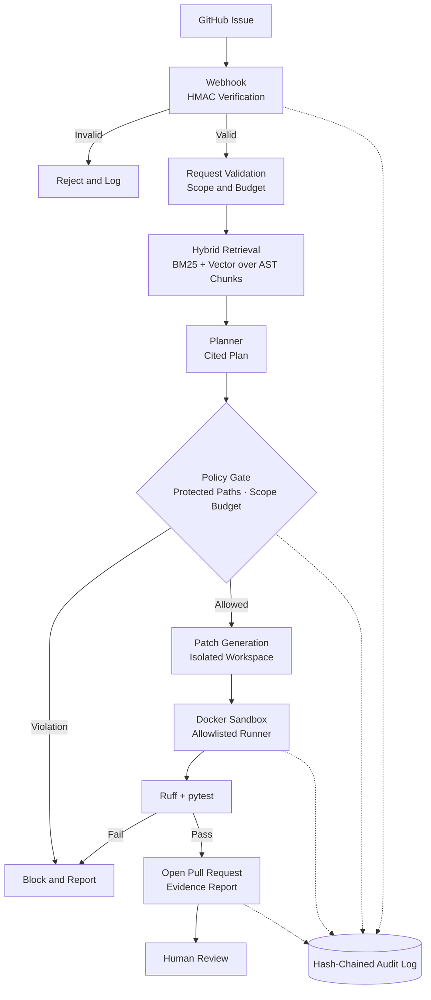

<div align="center">

# 🛩️ PatchPilot

### Policy-Controlled Software Engineering Agent for GitHub

**Turns GitHub issues into validated, human-reviewed pull requests, with strict deterministic policy gates between the LLM and every action.**

[](https://www.python.org/)
[](https://fastapi.tiangolo.com/)
[](https://www.docker.com/)
[](https://docs.pytest.org/)
[](https://docs.astral.sh/ruff/)
[](LICENSE)

</div>

---

## 📌 Overview

**PatchPilot** is a policy-controlled software engineering agent. Given a GitHub issue, it retrieves code evidence, writes a bounded plan, generates a patch in an isolated workspace, runs checks in a Docker sandbox, and opens a pull request for **human review**.

The LLM never acts directly. Every action passes through deterministic policy gates, and commands run only through an allowlisted check runner.

> **Never open a pull request unless the change is scoped, evidence-backed, validated by deterministic checks, and approved by policy.**

---

## ✨ Key Capabilities

### 🤖 Typed State-Machine Workflow

- Explicit, typed workflow: `issue → retrieval → plan → patch → sandboxed checks → PR`.
- Deterministic transitions: a policy violation routes to a block-and-report state and never reaches patch application or PR creation.
- **No auto-merge by default.** A human reviews every PR.

### 🔍 Hybrid Code Retrieval

- **BM25 + vector similarity** over **AST-based Python chunks**.
- Chunks follow code structure (modules, classes, functions), not arbitrary token windows.
- **Every plan and PR cites exact file paths, line ranges, and the pinned commit SHA.**

### 🛡️ Safety & Policy Controls

- **Protected-path rules** and **scope budgets** (files and lines changed) enforced before any patch is applied.
- **Allowlisted check runner** inside a **Docker sandbox**: non-root, resource-limited.
- **HMAC-verified webhooks** so only authentic GitHub events trigger runs.
- **Hash-chained audit log** so tampering with any past event is detectable.
- Prompt-injection resistance: repository text is treated as untrusted data, never as instructions.

### ✅ Deterministic Validation

- Ruff linting and pytest run in the sandbox, with results stored as structured artifacts.
- The LLM cannot override check results or policy decisions.

### 🧪 Tested & CI-Backed

- **51 tests**, including adversarial cases: prompt injection, protected-path edits, and malformed patches.
- **CI pipeline** running linters, tests, and a benchmark harness.

---

## 📊 Results

| Area | Result |
|---|---:|
| Automated tests | **51** |
| Adversarial coverage | Prompt injection, protected-path edits, malformed patches |
| CI | Linters + tests + benchmark harness |
| Benchmark resolution rate | _TBD_ |
| Retrieval recall@k | _TBD_ |
| Policy compliance | _TBD_ |

> Fill in the TBD rows from your benchmark harness output.

---

## 🏗️ Architecture



### Task Flow

1. **Webhook** arrives and its HMAC signature is verified.
2. **Validation** checks the request against scope and budget limits.
3. **Retrieval** returns hybrid-ranked AST chunks with path, line range, and commit SHA.
4. **Planner** writes a plan that cites exact evidence.
5. **Policy gate** blocks protected-path edits and over-budget changes.
6. **Patch** is generated in an isolated workspace.
7. **Sandbox** runs Ruff and pytest through the allowlisted runner.
8. **PR** is opened with the plan, evidence, diff summary, and check results.
9. **Human** reviews and decides. Nothing merges automatically.

Each step is recorded in the hash-chained audit log.

---

## 🧩 Tech Stack

| Layer | Tools |
|---|---|
| Language | Python |
| Backend API | FastAPI |
| Sandbox | Docker (non-root, resource-limited) |
| Validation | pytest, Ruff |
| VCS integration | GitHub API |
| Retrieval | BM25 + vector similarity over AST-based chunks |
| Control plane UI | Streamlit |

---

## 📂 Project Structure

> Adjust this tree to match your actual repository layout.

```text
patchpilot/
├── app/
│   ├── api/              # FastAPI routes and webhook endpoint
│   ├── workflow/         # Typed state machine
│   ├── retrieval/        # AST chunker, BM25, vector search
│   ├── policy/           # Protected paths, scope budgets
│   ├── sandbox/          # Docker allowlisted check runner
│   ├── github/           # GitHub API client, PR creation
│   └── audit/            # Hash-chained audit log
├── benchmarks/           # Benchmark harness and tasks
├── tests/                # 51 tests, incl. adversarial cases
├── ui.py                 # Streamlit control plane
├── .github/workflows/    # CI: lint, test, benchmark
└── requirements.txt
```

---

## 🚀 Quick Start

### 1. Clone and install

```bash
git clone https://github.com/rj1230/PatchPilot.git
cd PatchPilot
pip install -r requirements.txt
```

### 2. Configure environment variables

```env
GITHUB_TOKEN=your_github_token
GITHUB_WEBHOOK_SECRET=your_webhook_secret
LLM_API_KEY=your_llm_api_key
```

### 3. Start the API

```bash
uvicorn app.main:app --host 127.0.0.1 --port 8000 --reload
```

### 4. Launch the control plane

```bash
streamlit run ui.py
```

### 5. Run tests and lint

```bash
ruff check .
pytest
```

### 6. Run the benchmark harness

```bash
python -m benchmarks.run
```

---

## 🛡️ Safety Model

PatchPilot treats issue text, repository content, and model output as **untrusted input**:

- **Deterministic gates:** the policy engine, not the LLM, decides what is permitted.
- **Protected paths and scope budgets:** limit what a patch may touch before it is applied.
- **Allowlisted check runner:** no arbitrary shell. Only pre-approved checks run.
- **Docker sandbox:** non-root and resource-limited.
- **HMAC-verified webhooks:** unauthenticated events are rejected.
- **Hash-chained audit log:** every decision is recorded and tamper-evident.
- **Human review:** no auto-merge by default.

---

## 🗺️ Roadmap

Planned, not yet implemented:

- [ ] Published benchmark results with baseline and holdout splits
- [ ] Multi-attempt repair loop with strict retry budgets
- [ ] Coverage-delta and dependency/secret scanning gates
- [ ] OpenTelemetry tracing and metrics dashboards
- [ ] Postgres/pgvector data plane and queue-backed workers
- [ ] LangGraph-based agent orchestration

---

## ⚠️ Known Limitations

- Python repositories using pytest and Ruff only.
- GitHub only.
- Auth, infrastructure, migrations, and CI changes are blocked by default.

---

## 📄 License

Released under the [MIT License](LICENSE).

---

<div align="center">

*Build the vertical slice first. Measure it. Secure it. Then expand it.*

</div>
# PatchPilot

Policy-controlled agent that turns GitHub issues into validated, review-ready pull requests.
The LLM proposes (plan, patch). Deterministic code decides (policy, sandbox, state transitions). No auto-merge exists.

```
issue -> index @ pinned SHA -> hybrid retrieval (cited) -> plan -> POLICY -> patch -> POLICY(diff)
      -> ruff -> pytest (sandbox) -> required-check gate -> [human approval if risky] -> PR with evidence
              ^______ bounded repair loop (max 3 attempts) ______|        failures -> BLOCK_AND_REPORT
```

## Quick start
```bash
pip install -e ".[dev]"
pytest                      # 51 tests
patchpilot bench            # scripted demo suite, no API key neededa
export ANTHROPIC_API_KEY=...
patchpilot run --repo examples/validator_bug --title "validate_email accepts empty string" \
  --body "validate_email('') must return False"            # add --docker for the hardened sandbox
uvicorn --factory patchpilot.api.app:create_app            # webhooks + /tasks API (see env below)
```
API env: `GITHUB_WEBHOOK_SECRET`, `PATCHPILOT_POLICY`, `PATCHPILOT_REPOS='{"acme/api":"/srv/repos/api"}'`.
Wire `Settings.llm_factory` and `pr_client_factory` (GitHubClient) when embedding the app.

## Layout
`domain/` models, state machine, policy engine, audit chain - `repository/` indexer + retrieval - `sandbox/` allowlisted runner
- `agents/` prompts, patcher, workflow - `integrations/` GitHub - `api/` FastAPI - `evaluation/` benchmark - `policies/` YAML.

## Safety statement
No default auto-merge or deploy; protected paths blocked at plan, edit and diff stages; ephemeral per-attempt workspaces;
allowlisted commands only; secrets scrubbed from child processes; tamper-evident audit log; human approval for medium/high risk.
See `docs/THREAT_MODEL.md` for controls, tests and **known limitations**.

## Demo (matches the blueprint)
1. `empty-email-bug`: plan cites `app/validators.py`, minimal fix + regression test, ruff + pytest green, PR evidence body.
2. `empty-email-repair`: first patch fails ruff, repair loop succeeds on attempt 2.
3. `ci-workflow-edit`: blocked at POLICY_CHECK before any patch is generated.
