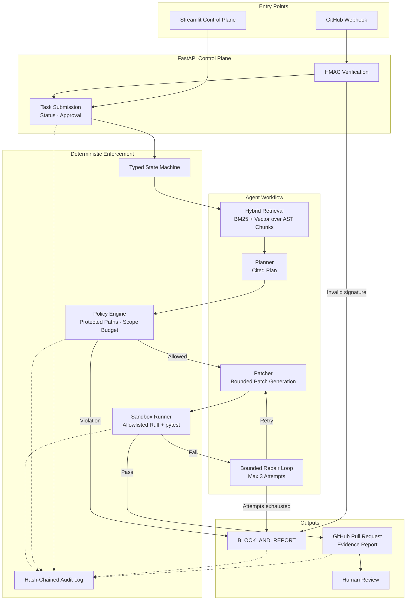

<div align="center">

# 🛩️ PatchPilot

### Policy-Controlled Software Engineering Agent for GitHub

**Turns GitHub issues into validated, human-reviewed pull requests — with deterministic policy gates between the LLM and every action.**

[](https://www.python.org/)
[](https://fastapi.tiangolo.com/)
[](https://streamlit.io/)
[](https://www.docker.com/)
[](https://docs.pytest.org/)
[](https://docs.astral.sh/ruff/)
[](LICENSE)

</div>

---

## 📌 Overview

**PatchPilot** is a policy-controlled software engineering agent. Given a GitHub issue, it retrieves code evidence, writes a bounded plan, generates a patch in an isolated workspace, runs deterministic checks, and opens a pull request for **human review**.

The LLM proposes the plan and patch. Deterministic code decides whether the workflow may proceed through policy checks, sandbox validation, state transitions, and PR creation.

```text
issue -> index @ pinned SHA -> hybrid retrieval (cited) -> plan -> POLICY -> patch -> POLICY(diff)
      -> ruff -> pytest (sandbox) -> required-check gate -> PR with evidence
             ^______ bounded repair loop (max 3 attempts) ______|
             failures -> BLOCK_AND_REPORT
```

> **PatchPilot never auto-merges.** A human reviews every pull request.

---

## ✨ Key Capabilities

### 🤖 Typed State-Machine Workflow

- Explicit workflow: `issue → retrieval → plan → patch → sandboxed checks → PR`.
- Deterministic transitions: policy violations route to `BLOCK_AND_REPORT`; they never reach patch application or PR creation.
- Bounded repair loop with a maximum of three attempts.
- No auto-merge by default; every PR requires human review.

### 🔍 Hybrid Code Retrieval

- **BM25 + vector similarity** over **AST-based Python chunks**.
- Chunks follow code structure — modules, classes, and functions — rather than arbitrary token windows.
- Plans and PRs cite exact file paths, line ranges, and the pinned commit SHA.

### 🛡️ Safety and Policy Controls

- Protected-path rules and scope budgets enforced before a patch is applied.
- Allowlisted check runner inside a non-root, resource-limited Docker sandbox.
- HMAC-verified GitHub webhooks.
- Hash-chained, tamper-evident audit log.
- Repository text and model output are treated as untrusted data, never as instructions.
- Human approval required for medium- and high-risk changes.

### ✅ Deterministic Validation

- Ruff and pytest run through an allowlisted sandbox runner.
- Check results are stored as structured artifacts.
- The LLM cannot override check results or policy decisions.

### 🧪 Tested and CI-Backed

- **51 tests**, including adversarial cases for prompt injection, protected-path edits, and malformed patches.
- CI runs linting, tests, and the benchmark harness.

---

## 🏗️ Architecture

PatchPilot separates **probabilistic reasoning** from **deterministic enforcement**. The LLM proposes a plan and patch; the policy engine, sandbox runner, state machine, and audit chain decide whether that change may proceed.



### Architectural Layers

| Layer | Location | Responsibility |
|---|---|---|
| **Control plane** | `src/patchpilot/api/` | FastAPI webhook intake, task submission, status, health, repository allowlisting, and human approval endpoints |
| **Agent workflow** | `src/patchpilot/agents/` | LLM provider abstraction, prompts, planning, patch generation, workflow orchestration, and bounded repair |
| **Domain core** | `src/patchpilot/domain/` | Typed models, state machine, policy engine, and hash-chained audit log |
| **Repository intelligence** | `src/patchpilot/repository/` | Repository indexing, AST chunking, BM25 + vector retrieval, and evidence citations |
| **Sandbox enforcement** | `src/patchpilot/sandbox/` | Allowlisted command execution and Ruff/pytest validation |
| **GitHub integration** | `src/patchpilot/integrations/` | GitHub API client and pull-request creation |
| **Evaluation** | `src/patchpilot/evaluation/` | Benchmark harness, scripted demo cases, and reproducible evaluation runs |
| **Control-plane UI** | `ui.py` | Streamlit dashboard for submitting issues, inspecting evidence, monitoring state, and approving risky changes |
| **Policy configuration** | `policies/` | YAML-defined protected paths, scope budgets, and workflow constraints |

### Execution Flow

1. An issue arrives through the Streamlit control plane or an HMAC-verified GitHub webhook.
2. The FastAPI control plane validates the request and creates a tracked task.
3. The repository is indexed at a pinned commit; hybrid retrieval returns AST-based code chunks with file paths, line ranges, and commit evidence.
4. The planner produces an evidence-cited plan.
5. The policy engine checks protected paths and change-scope budgets before patch generation proceeds.
6. The patcher generates a candidate patch in an ephemeral workspace.
7. The sandbox runner executes only allowlisted Ruff and pytest commands.
8. A failed validation enters a bounded repair loop, with a maximum of three attempts.
9. Successful runs open an evidence-backed pull request; policy violations or exhausted retries route to `BLOCK_AND_REPORT`.
10. Every material decision, check result, and state transition is appended to the hash-chained audit log.

### Design Principle

> **The LLM proposes; deterministic infrastructure decides.**

The model can suggest a plan or patch, but it cannot bypass protected-path rules, scope budgets, sandbox checks, state-machine transitions, audit logging, or human review.

---

## 📊 Results

| Area | Result |
|---|---:|
| Automated tests | **51** |
| Adversarial coverage | Prompt injection, protected-path edits, malformed patches |
| CI | Linters + tests + benchmark harness |
| Benchmark resolution rate | _TBD_ |
| Retrieval recall@k | _TBD_ |
| Policy compliance | _TBD_ |

> Fill these rows from reproducible benchmark output before publishing final results.

---

## 🧩 Tech Stack

| Layer | Tools |
|---|---|
| Language | Python |
| Backend API | FastAPI |
| Control-plane UI | Streamlit |
| LLM provider | Groq-compatible API |
| Sandbox | Docker, non-root and resource-limited |
| Validation | pytest, Ruff |
| VCS integration | GitHub API |
| Retrieval | BM25 + vector similarity over AST-based chunks |
| Policy configuration | YAML |

---

## 📂 Project Structure

```text
patchpilot/
├── src/patchpilot/
│   ├── agents/           # LLM provider, prompts, patcher, workflow
│   ├── api/              # FastAPI control plane and webhook endpoint
│   ├── domain/           # Models, state machine, policy engine, audit chain
│   ├── evaluation/       # Benchmark harness and demo cases
│   ├── integrations/     # GitHub API client and PR creation
│   ├── repository/       # Repository indexer, AST chunks, hybrid retrieval
│   └── sandbox/          # Allowlisted Ruff/pytest runner
├── examples/
│   └── validator_bug/    # Runnable end-to-end demo repository
├── policies/
│   └── default.yaml      # Protected paths, scope budgets, workflow policy
├── tests/                # Unit, integration, and adversarial tests
├── docs/
│   └── THREAT_MODEL.md   # Security controls and known limitations
├── ui.py                 # Streamlit control plane
├── pyproject.toml
└── .github/workflows/ci.yml
```

---

## 🚀 Quick Start

### 1. Clone and install

```bash
git clone [https://github.com/rj1230/patchpilot.git](https://github.com/rj1230/patchpilot.git)
cd patchpilot
pip install -e ".[dev]"
```

### 2. Run tests and lint

```bash
pytest          # 51 tests
ruff check .
```

### 3. Run the offline benchmark demo

```bash
patchpilot bench
```

### 4. Run an issue end to end

```bash
export GROQ_API_KEY=your_groq_api_key

patchpilot run \
  --repo examples/validator_bug \
  --title "validate_email accepts empty string" \
  --body "validate_email('') must return False"

# Use the hardened Docker sandbox:
patchpilot run --repo examples/validator_bug --docker
```

### 5. Start the API control plane

**Linux / macOS:**

```bash
export GROQ_API_KEY=your_groq_api_key
export PATCHPILOT_REPOS='{"demo":"/absolute/path/to/demo_repo"}'

uvicorn --factory patchpilot.api.app:create_app --port 8010 --reload
```

**Windows PowerShell:**

```powershell
$env:GROQ_API_KEY="your_groq_api_key"
$env:PATCHPILOT_REPOS='{"demo":"C:/absolute/path/to/demo_repo"}'

uvicorn --factory patchpilot.api.app:create_app --port 8010 --reload
```

Use forward slashes in `PATCHPILOT_REPOS`, even on Windows, because the value is parsed as JSON.

### 6. Launch the Streamlit control plane

In a second terminal:

```bash
export PATCHPILOT_API_URL="http://127.0.0.1:8010"
streamlit run ui.py
```

**Windows PowerShell:**

```powershell
$env:PATCHPILOT_API_URL="http://127.0.0.1:8010"
streamlit run ui.py
```

### 7. Verify the API

```bash
curl http://127.0.0.1:8010/health
curl http://127.0.0.1:8010/repos
curl http://127.0.0.1:8010/tasks
```

Expected:

```json
{
  "status": "ok",
  "llm_ready": true,
  "repositories": 1
}
```

---

## 🔐 Environment Variables

| Variable | Required | Purpose |
|---|---:|---|
| `GROQ_API_KEY` | Yes for LLM runs | API key for the Groq-compatible LLM provider |
| `PATCHPILOT_REPOS` | Yes for API runs | JSON map of allowed repository names to local absolute paths |
| `PATCHPILOT_POLICY` | No | Path to a YAML policy file |
| `PATCHPILOT_SANDBOX` | No | Set to `docker` to use the hardened Docker sandbox |
| `GITHUB_WEBHOOK_SECRET` | For webhooks | Secret used to verify GitHub webhook HMAC signatures |
| `PATCHPILOT_API_URL` | For Streamlit | Base URL of the running FastAPI control plane |

Never commit real API keys, GitHub tokens, or webhook secrets.

---

## 🧪 Demo Scenarios

| Scenario | Expected behavior |
|---|---|
| `empty-email-bug` | Plan cites `app/validators.py`; minimal fix plus regression test; Ruff and pytest pass; PR contains evidence. |
| `empty-email-repair` | First patch fails Ruff; bounded repair loop succeeds on attempt 2. |
| `ci-workflow-edit` | Blocked at `POLICY_CHECK` before any patch is generated. |

---

## 🛡️ Safety Model

PatchPilot treats issue text, repository content, and model output as **untrusted input**.

- Deterministic policy gates decide what is permitted.
- Protected paths are blocked at plan, edit, and diff stages.
- Scope budgets limit files and lines changed.
- Commands run only through an allowlisted runner; no arbitrary shell execution.
- Each attempt uses an ephemeral workspace.
- Child-process secrets are scrubbed.
- Webhooks are HMAC-verified.
- The audit log is hash-chained and tamper-evident.
- No default auto-merge or deployment.
- Human approval is required for medium- and high-risk changes.

See [`docs/THREAT_MODEL.md`](docs/THREAT_MODEL.md) for controls, tests, and known limitations.

---

## 🗺️ Roadmap

- [ ] Published benchmark results with baseline and holdout splits
- [ ] Coverage-delta and dependency/secret-scanning gates
- [ ] OpenTelemetry tracing and metrics dashboards
- [ ] Postgres/pgvector data plane and queue-backed workers
- [ ] LangGraph-based agent orchestration
- [ ] GitHub App installation flow with minimum permissions
- [ ] Policy simulation and dry-run mode

---

## ⚠️ Known Limitations

- Currently supports Python repositories using pytest and Ruff.
- GitHub is the only supported forge.
- Authentication, infrastructure, migration, and CI changes are blocked by default.
- Docker-based sandboxing requires Docker to be installed and running locally.

---

## 📄 License

Released under the [MIT License](LICENSE).

---

<div align="center">

*PatchPilot optimizes for verified, scoped, safe repository changes — not for appearing autonomous.*

</div>
